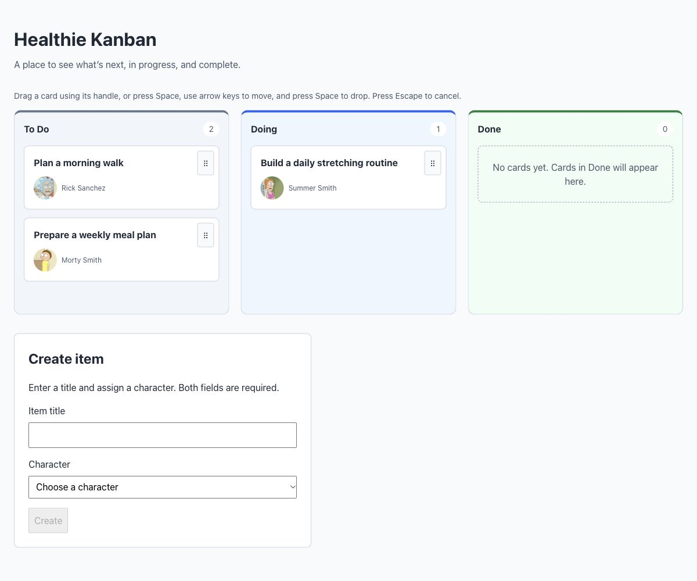

# Healthie React Kanban



A React + TypeScript interview exercise built with Vite and plain CSS. Organize
items across To Do, Doing, and Done, with a Rick and Morty character assigned to
each newly created item. Board changes live only in the current browser session.

## Prerequisites and installation

Use Node.js 24.15.0+ on the 24.x line and npm. Node 26+ is also compatible;
Node 22 users need 22.22.2+ for the test dependencies. Internet access is needed
to install packages and load the public character API and avatar images.

From the repository directory:

```sh
npm ci
```

Use `npm install` when intentionally changing dependencies and include the updated
`package-lock.json` with those changes.

## Development and verification

```sh
npm run dev        # Vite development server; open the printed local URL
npm run typecheck  # Strict TypeScript checks for app, config, and tests
npm run lint       # Oxlint
npm test           # Node test runner, React Testing Library, and jsdom
npm run build      # Typecheck and production build in dist/
npm run preview    # Serve dist/ locally after building
```

The development URL is normally `http://localhost:5173`. `preview` is for local
build verification. Tests use native TypeScript stripping and Vite's existing TSX
transform; they use mocked API responses and need no live service or browser.

## Main features

- Three columns with derived card counts and explicit empty placeholders.
- One shared GraphQL request for the first page of Rick and Morty characters.
- Create cards in To Do with a trimmed, nonblank title and a required character.
- Character names and avatars, including unavailable-character/image fallbacks.
- Pointer and keyboard dragging between columns, within-column reordering, and
  drops into empty columns. Use Space to pick up/drop, arrows to move, Escape
  to cancel. Use the labeled handle on each card.
- A brief rocket and glow when a card enters Done from an incomplete column;
  reordering Done does not celebrate. Reduced-motion preferences suppress it.
- Character loading, error/retry, and empty-result messages; creation stays
  disabled until a valid assignment is available.
- A three-column desktop layout that stacks below 48rem, with labeled form
  controls, visible drag-handle focus, and drag announcements.

## Known limitations

- Refreshing resets the board. There is no persistence, editing, deletion,
  authentication, backend, or multi-user synchronization.
- The three seed cards reference Rick Sanchez, Morty Smith, and Summer Smith
  from the API. Names and avatars show fallbacks until characters load or if
  the request fails.
- Only the API's first character page is available; no search or pagination.
  API/network failure prevents creation, but existing cards can still move.
- GraphQL responses are typed, without comprehensive runtime schema validation.
- Board lookups scan small arrays; there is no normalization or virtualization.
- Drag announcements use library-default item IDs. Full screen-reader and
  physical touch-device testing has not been completed.
- Automated tests cover state transitions, API responses, rendering, and creation,
  but do not drive drag sensors or animation timing. Hook retry/abort races and
  image-error events also lack automated integration coverage.

See [architecture](docs/ARCHITECTURE.md) for implementation details and verification
coverage, and [interview notes](docs/INTERVIEW_NOTES.md) for technical talking points
and possible follow-ups. [AGENTS.md](AGENTS.md) records contribution conventions.
